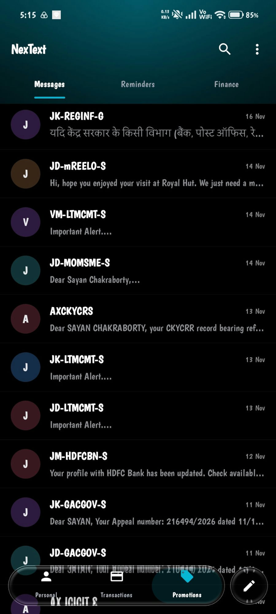
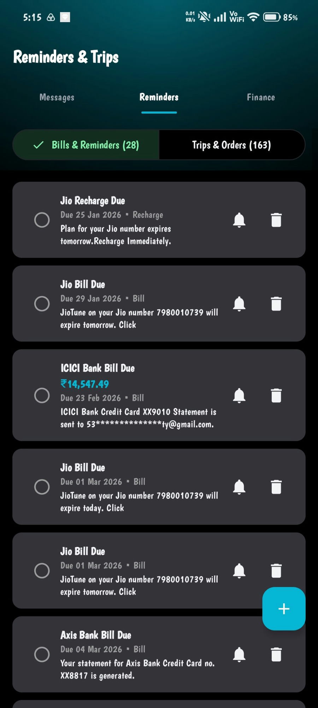
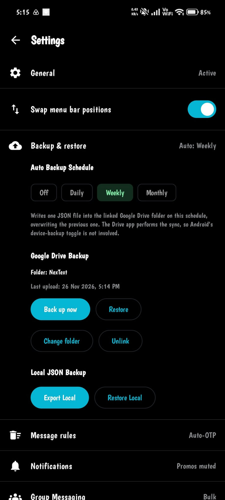
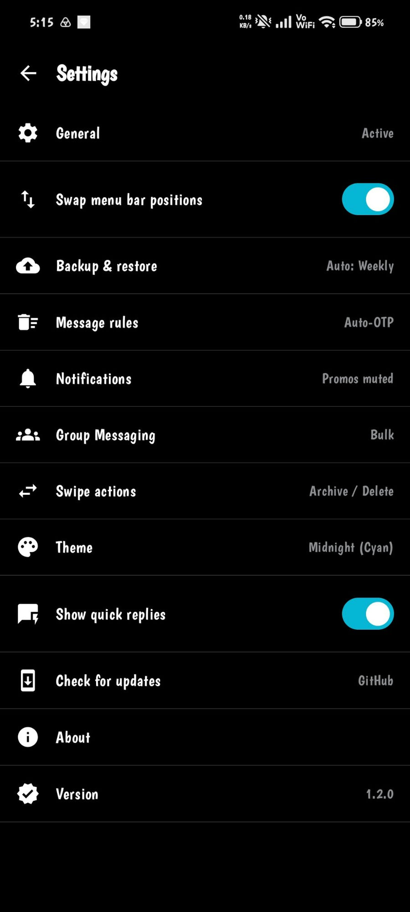

<div align="center">


### A privacy-first SMS organizer that reads your messages like a person would — on your phone, never on a server


<br/>

[](https://github.com/Sayan201/NexText/releases/latest)
[](https://github.com/Sayan201/NexText/releases)
[](https://github.com/Sayan201/NexText/stargazers)
[](https://github.com/Sayan201/NexText/network/members)
[](LICENSE)
[](https://github.com/Sayan201/NexText/issues)

<br/>


<br/>

<a href="https://github.com/Sayan201/NexText/releases/latest">
  
</a>
&nbsp;
<a href="#-screenshots">
  
</a>

<br/><br/>

<p align="center">
  <a href="#-overview"><b>Overview</b></a> ·
  <a href="#-screenshots"><b>Screenshots</b></a> ·
  <a href="#-features"><b>Features</b></a> ·
  <a href="#-privacy--network"><b>Privacy</b></a> ·
  <a href="#-google-drive-backup"><b>Drive Backup</b></a> ·
  <a href="#-download"><b>Download</b></a> ·
  <a href="#-tech-stack"><b>Tech Stack</b></a> ·
  <a href="#-faq"><b>FAQ</b></a> ·
  <a href="#-license"><b>License</b></a>
</p>


</div>

## 🔭 Overview

**NexText** is a full replacement for your default SMS app — one that actually understands what lands in your inbox.

Banks send you a debit. NexText logs it in a passbook. A courier texts a tracking number. NexText files it under trips and deliveries. A bank reminds you about a card bill. NexText puts it in reminders with the amount and due date. An OTP arrives. NexText lifts the code out and hands you a copy button before you even open the thread.

Every message is parsed **on the device**. There is no account, no sync server, no analytics SDK, and no crash reporter. The only network request the app makes is a version check against GitHub Releases — the same request that lets it update itself without a store.

> [!NOTE]
> **Your messages never leave your phone.** Categorization, OTP extraction, transaction parsing, reminders and search are local Kotlin. The update check sends no message content, no identifiers and no telemetry — it is a `GET` for a public release tag.

<div align="center">

| 💬 Organize | 🔐 Extract | 💸 Track | ⏰ Remember | ☁️ Back up |
|:---:|:---:|:---:|:---:|:---:|
| Every thread, sorted | OTPs, one tap | Spend, live | Bills & deliveries | One file, no stacking |

</div>

---

## 📸 Screenshots

<div align="center">

<table>
<tr>
<td align="center">

<br/><b>💬 Inbox</b>
<br/><sub>Personal · Transactions · Promotions</sub>
</td>
<td align="center">

<br/><b>⏰ Reminders &amp; Trips</b>
<br/><sub>Bills, EMIs, PNRs, deliveries</sub>
</td>
<td align="center">

<br/><b>💸 Passbook</b>
<br/><sub>Monthly spend, accounts, categories</sub>
</td>
</tr>
<tr>
<td align="center">

<br/><b>☁️ Drive Backup</b>
<br/><sub>Linked folder, schedule, one file</sub>
</td>
<td align="center">

<br/><b>⚙️ Settings</b>
<br/><sub>Theme, rules, updates, version</sub>
</td>
<td align="center" valign="middle">
<br/>
<b>No account.</b><br/>
<b>No analytics.</b>
<br/><br/>
<a href="app/src/main/java/com/nextext/sms/update/AppUpdater.kt"></a>
<br/>
<sub>the whole network layer, in one file</sub>
</td>
</tr>
</table>

</div>

---

## ✨ Features

### 💬 A messaging app that sorts itself

<table>
<tr>
<td width="50%" valign="top">

**Smart on-device categorization**

Every message is classified into **Personal**, **Transactions**, **Promotions** or **Spam** — including Indian DLT headers like `AD-HDFCBK`, `VK-SBIINB`, `AX-AXISBK`. Override any sender by hand, block the ones you never want to see, star the ones you do.

</td>
<td width="50%" valign="top">

**1-tap OTP copy**

Detects 4–8 digit verification codes, adds a **Copy OTP** button straight in the notification shade and inline in the thread, and can auto-delete old OTPs after 24 hours.

</td>
</tr>
<tr>
<td valign="top">

**Notifications that act**

Copy OTP, **direct reply**, mark read, or delete — right from the shade. Tapping a notification opens that exact conversation, not the inbox.

</td>
<td valign="top">

**Full-text search, offline**

SQLite FTS4 indexing across every message. Search is instant and never phones home.

</td>
</tr>
</table>

### 💸 Passbook & expense tracker

NexText reads the numbers out of bank SMS and builds a live picture of your money:

- **Multi-currency** — INR (`₹`/`Rs.`), USD, EUR, GBP
- **Every channel** — UPI, card spends, ATM withdrawals, transfers
- **Account awareness** — last-4 digits and available balance
- **Monthly dashboard** — spent vs credited, spend by category, per-account transaction counts
- **Filterable ledger** — All / Debits / Credits / UPI / Cards

### ⏰ Reminders, trips & deliveries

Bills, EMIs, recharges, IRCTC PNRs, flight bookings and courier updates are extracted automatically and split into **Bills & Reminders** and **Trips & Orders**, with due dates, amounts and notifications. Anything the parser misses, you can add by hand.

### 🔄 Updates without a store

NexText updates itself from GitHub Releases:

- On launch it asks GitHub for the latest release tag (silent, 8-second timeout, fails quietly offline)
- If the tag is newer than the installed version, a flyout shows the release notes and a download button
- The APK downloads to cache with a progress bar, then hands off to Android's package installer
- If **Install unknown apps** isn't granted for NexText, the app opens that settings screen first
- **Don't show again** dismisses that specific version — an **Update** capsule stays in the inbox header until you take it

No store review queue, no staged rollout, no waiting. [Full network details below](#-privacy--network).

### 🎨 Liquid Glass design

- Translucent floating bottom capsule with **real refraction** — AGSL shaders and `GraphicsLayer` backdrop sampling, not a blur overlay
- **Liquid Glass droplet** under the selected tab: it pops wider and taller on every switch, refracts the rim, and carries a soft outer glow
- **Frost** control instead of opacity — slide from crystal clear to heavy frost without ever tinting the glass black
- Spring-driven tab transitions and outward glass magnification on touch
- **Pitch Black** OLED theme, optional **Material 3** mode, cyan default accent plus custom accents
- **Swap menu bar positions**, plus Glass navigation bar size and style customisation

### ☁️ Backup that behaves

One file in your Google Drive, overwritten on a schedule. No timestamped pile, no manual cleanup. [Full details below](#-google-drive-backup).

---

## 🔐 Privacy & network

NexText is not "offline" any more — it updates itself from GitHub. So here is the exact list of everything that touches the network, with no marketing gloss.

### What stays on the device

| Data | Where it lives |
|---|---|
| Every SMS and MMS body | Android's SMS database + NexText's Room database, on the phone |
| Sender names, categories, overrides, blocklists | Room database, on the phone |
| Extracted OTPs, transactions, balances, reminders | Room database, on the phone |
| Search index | SQLite FTS4, on the phone |
| Preferences, linked Drive folder URI | DataStore, on the phone |

Nothing in that table is uploaded. There is no account to sign into, no device ID, no advertising ID, and no analytics or crash-reporting dependency in the build.

### Every network request the app can make

| Request | When | What it carries |
|---|---|---|
| `GET https://api.github.com/repos/Sayan201/NexText/releases/latest` | App launch, and when you tap **Check for updates** | Nothing but the HTTP request itself. No version, no device info, no ID. GitHub sees your IP and the `NexText-Android` user agent, like any web request. |
| `GET` on the release APK URL | Only when you tap **Download & install** | Same — an anonymous download of a public file |
| Drive document write | On the backup schedule | **Not NexText's network code.** The bytes go to a folder through Android's Storage Access Framework and the Google Drive app performs the upload |

That is the complete list. If you block `api.github.com` at the DNS or firewall level, the app still works exactly as before — the launch check fails silently and manual checks report "could not check for updates".

### What the update check does not do

- It does not send your version, your messages, your contacts, or any identifier
- It does not run in the background — no WorkManager job, no periodic ping. It fires when the app opens and when you ask
- It does not download anything until you press the button
- It cannot install a build signed with a different key: Android's package installer rejects signature mismatches, so a tampered APK fails at install time

### Permissions, in plain language

| Permission | Why |
|---|---|
| `READ_SMS`, `WRITE_SMS`, `SEND_SMS`, `RECEIVE_SMS`, `RECEIVE_MMS`, `RECEIVE_WAP_PUSH` | Being a default SMS app — reading, sending, receiving, MMS |
| `READ_CONTACTS` | Names on threads and the compose screen |
| `READ_PHONE_STATE` | Dual-SIM detection |
| `POST_NOTIFICATIONS`, `VIBRATE` | Message, OTP and reminder notifications |
| `RECEIVE_BOOT_COMPLETED` | Reschedule reminders and the backup worker after a reboot |
| `INTERNET` | The GitHub update check and APK download — nothing else |
| `REQUEST_INSTALL_PACKAGES` | Handing a downloaded update to the package installer |

---

## ☁️ Google Drive Backup

NexText writes its backup through Android's **Storage Access Framework**, not the Google Drive REST API. The Google Drive app performs the upload, so NexText needs no OAuth client, no Cloud project and no API key.

### How it works

1. **Settings → Backup & restore → Choose Drive folder.**
2. The system folder picker opens. Switch to the Google account you want in its drawer, then pick or create a folder — for example `NexText Backups`.
3. NexText calls `takePersistableUriPermission` and stores the folder URI. That URI *is* the account binding: every later backup goes to the folder under whichever account you selected. If that account is signed out of the phone, the write fails or queues in the Drive app — it never silently lands in another account.
4. Each run serializes the database to bytes **in memory** and writes them into a single document, `nextext-backup.json`, using `openOutputStream(doc, "wt")`. Truncate-and-write means the previous backup is replaced, not appended.

### Guarantees and limits

| Property | Behavior |
|---|---|
| Local copies | **None.** The backup is built in memory; no cache file is created. Legacy `files/auto_backups/` is deleted on the next worker run. |
| Drive copies | **One.** The same `nextext-backup.json` is overwritten each run. |
| Schedule | WorkManager periodic work — 1 / 7 / 30 days — with exponential backoff, surviving reboot. |
| Immediate run | Linking a folder while a schedule is active fires one backup right away. |
| System backup toggle | **Irrelevant.** Android Auto Backup is a separate 25 MB system snapshot; this path does not use it. |
| Server confirmation | **None.** The app confirms the bytes were written to the provider, not that Google received them. |
| Requirements | The Google Drive app must be installed and the folder grant must still be valid. |
| Account change | Unlink, then pick a folder again. The app cannot enumerate accounts or query which one owns a URI. |

### Restoring

**Restore** reads `nextext-backup.json` from the linked folder and merges blocked senders, category overrides, messages and reminders — exactly like the local SAF restore. Local **Export / Restore** to any document provider is still there for people who don't want Drive at all.

### If an upload fails

| Failure | What happens |
|---|---|
| Grant revoked (Drive data cleared, app uninstalled, permission removed) | The write throws, the link is cleared automatically, and Settings asks for a folder again. |
| Account signed out / offline | WorkManager retries with exponential backoff; the link is kept. |
| Folder deleted | The next run recreates the document if the grant survives, otherwise the link is dropped. |

### Why the Drive path needs no network code

The Drive app holds the network access and the OAuth session. NexText only writes a document through a `ContentProvider` — the same mechanism used to save to a local file. The trade-off is that the backup file is visible in your Drive, and there is no programmatic account picker or hidden app-data folder (those require the Drive REST API with `drive.appdata`).

---

## ⬇️ Download

Get the latest build from the **[Releases page](https://github.com/Sayan201/NexText/releases/latest)**.

<div align="center">

| APK | What it is |
|---|---|
| 🟢 `app-release.apk` | Signed, minified release build — **recommended** |
| 🔵 `app-debug.apk` | Debug build with logging, for testing and bug reports |

</div>

> [!TIP]
> Install once from the APK, and every later version arrives in-app: **Settings → Check for updates**, or the **Update** capsule in the inbox header.
>
> Requires **Android 8.0 (API 26)** or newer. Set NexText as your default SMS app to receive and send messages. Updates install over the top and keep your data — Android only accepts them because every release is signed with the same key.

---

## 🛠 Tech Stack

<div align="center">


<br/><br/>

| Layer | What's used |
|---|---|
| **Language** | Kotlin 2.0, Coroutines + Flow |
| **UI** | Jetpack Compose, Material 3, Haze blur, custom AGSL refraction shaders |
| **Database** | Room + SQLite **FTS4** full-text search |
| **Background work** | WorkManager (reminders, OTP cleanup, Drive backup) |
| **Preferences** | Jetpack DataStore |
| **Networking** | `HttpURLConnection` + `org.json` — no HTTP client dependency, ~180 lines in `update/AppUpdater.kt` |
| **Updates** | GitHub Releases API → APK download → `FileProvider` → Android package installer |
| **CI/CD** | GitHub Actions — tests, debug APK, signed release APK, automatic GitHub Release on tag |

</div>

---

## 🧱 Building

### GitHub Actions (recommended)

Every push to `main` runs `testDebugUnitTest` and builds the debug APK. Pushing a version tag (e.g. `v1.3.0`) also builds the **signed release APK** and publishes a GitHub Release automatically — which is exactly what the in-app updater looks for.

### Local Gradle

```bash
gradle testDebugUnitTest assembleDebug
```

Release builds need the keystore environment variables used by the workflow:

```bash
export KEYSTORE_FILE=/path/to/release.jks
export KEYSTORE_PASSWORD=...
export KEY_ALIAS=...
export KEY_PASSWORD=...
gradle assembleRelease
```

> [!IMPORTANT]
> The updater downloads the asset named `app-release.apk`. Keep that filename in the workflow, and keep every release signed with the same keystore — otherwise installed copies will refuse the update.

---

## ❓ FAQ

<details>
<summary><b>Does NexText send my messages anywhere?</b></summary>
<br/>
No. Messages are parsed on the device and stored in a local database. The only network request the app makes is a version check against GitHub Releases, and it carries no message content, no device identifiers and no telemetry.
</details>

<details>
<summary><b>Why does it need the INTERNET permission now?</b></summary>
<br/>
So it can update itself from GitHub instead of waiting on a store. That permission is used by one file — <code>update/AppUpdater.kt</code> — to fetch the latest release tag and, if you tap the button, the APK. Nothing else in the app opens a connection.
</details>

<details>
<summary><b>What exactly does the update check send?</b></summary>
<br/>
A plain <code>GET</code> to <code>api.github.com/repos/Sayan201/NexText/releases/latest</code>. No version, no ID, no payload. GitHub sees the request, your IP and the <code>NexText-Android</code> user agent, the same as any browser hitting a public page.
</details>

<details>
<summary><b>Can I stop it from checking?</b></summary>
<br/>
Block <code>api.github.com</code> with a DNS filter or firewall. The launch check fails silently and everything else works normally; manual checks will report that they couldn't reach GitHub.
</details>

<details>
<summary><b>How do updates install?</b></summary>
<br/>
The APK downloads into the app cache, then Android's package installer takes over. The first time, you'll be asked to allow <b>Install unknown apps</b> for NexText. Android verifies the signature against the installed copy, so an update signed with a different key is rejected.
</details>

<details>
<summary><b>Will an update wipe my messages or settings?</b></summary>
<br/>
No. It's an in-place upgrade of the same package, signed with the same key. The database, preferences and Drive folder link survive.
</details>

<details>
<summary><b>How does Drive backup work without OAuth?</b></summary>
<br/>
NexText writes a document into a folder you pick with the system folder chooser. The Google Drive app owns the network call and the account session. NexText only hands it bytes through a <code>ContentProvider</code> — the same path used to save a file locally.
</details>

<details>
<summary><b>Will backups pile up in my Drive?</b></summary>
<br/>
No. There is exactly one file, <code>nextext-backup.json</code>, and every run overwrites it. Nothing is timestamped, nothing accumulates, and nothing needs deleting.
</details>

<details>
<summary><b>Which Google account does it upload to?</b></summary>
<br/>
Whichever account you selected in the folder picker. The folder URI is bound to that account. If the account is removed from the phone, the upload fails or queues and NexText asks you to link a folder again — it will not switch to another account.
</details>

<details>
<summary><b>Do I need Android's device backup turned on?</b></summary>
<br/>
No. That toggle controls Android Auto Backup, a separate system-managed snapshot. NexText's Drive upload is independent of it and works with the toggle off.
</details>

<details>
<summary><b>What happens if I uninstall the Google Drive app?</b></summary>
<br/>
The folder grant stops resolving. NexText clears the link and shows <b>Choose Drive folder</b> again. Local JSON export/import keeps working.
</details>

<details>
<summary><b>Can I use NexText without Google at all?</b></summary>
<br/>
Yes. Leave Drive unlinked and use <b>Export Local</b> / <b>Restore Local</b> with any document provider, or no backup at all. Updates still come from GitHub, which you can block or ignore.
</details>

<details>
<summary><b>Is NexText free?</b></summary>
<br/>
Yes — MIT licensed, source included. See <a href="LICENSE">LICENSE</a>.
</details>

---

## 🗒️ Changelog

Full history in **[CHANGELOG.md](CHANGELOG.md)**.

**Latest — v1.6.7**

- 🫧 **Liquid Glass droplet** under the selected tab — always visible, pops wider and taller on every switch, refracts the rim, frosted body, soft outer glow
- ❄️ **Frost** slider replaces Opacity: **0% crystal clear → 100% heavy frost**, never a black scrim
- 🎯 Active tab icon uses the accent colour on clear glass instead of flipping to white
- 🔄 In-app update checker against GitHub Releases, with release notes in a flyout
- ⬇️ APK download with progress, then hand-off to Android's package installer
- 🟡 **Update** capsule in the inbox header when a version is dismissed but still available
- 🔐 Network story written down: `INTERNET` is declared, used only by `update/AppUpdater.kt`
- 🧩 Settings copy and About text now state exactly what the network is for

---

## 📜 License

Copyright © 2026 **Sayan Chakraborty**

NexText is released under the **[MIT License](LICENSE)**.

<div align="center">

<br/>

### NexText

*Your inbox, finally intelligent.*

<br/>

[⭐ Star the repository](https://github.com/Sayan201/NexText)
&nbsp;&nbsp;•&nbsp;&nbsp;
[⬇️ Download](https://github.com/Sayan201/NexText/releases/latest)
&nbsp;&nbsp;•&nbsp;&nbsp;
[🐛 Report an issue](https://github.com/Sayan201/NexText/issues)

<br/>


</div>
