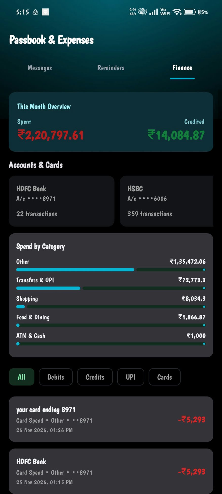

<div align="center">


### A privacy-first SMS organizer that reads your messages like a person would — on your phone, never on a server


<br/>

[](https://github.com/Sayan201/NexText/releases/latest)
[](https://github.com/Sayan201/NexText/releases)
[](https://github.com/Sayan201/NexText/stargazers)
[](https://github.com/Sayan201/NexText/network/members)
[](LICENSE)
[](https://github.com/Sayan201/NexText/issues)

<br/>


<br/>

<a href="https://github.com/Sayan201/NexText/releases/latest">
  
</a>
&nbsp;
<a href="#-screenshots">
  
</a>

<br/><br/>

<p align="center">
  <a href="#-overview"><b>Overview</b></a> ·
  <a href="#-screenshots"><b>Screenshots</b></a> ·
  <a href="#-features"><b>Features</b></a> ·
  <a href="#-google-drive-backup"><b>Drive Backup</b></a> ·
  <a href="#-download"><b>Download</b></a> ·
  <a href="#-tech-stack"><b>Tech Stack</b></a> ·
  <a href="#-faq"><b>FAQ</b></a> ·
  <a href="#-license"><b>License</b></a>
</p>


</div>

## 🔭 Overview

**NexText** is a full replacement for your default SMS app — one that actually understands what lands in your inbox.

Banks send you a debit. NexText logs it in a passbook. A courier texts a tracking number. NexText files it under trips and deliveries. A bank reminds you about a card bill. NexText puts it in reminders with the amount and due date. An OTP arrives. NexText lifts the code out and hands you a copy button before you even open the thread.

All of it happens **on the device**. No account, no sync server, no analytics, no `INTERNET` permission.

> [!NOTE]
> **Your messages never leave your phone.** Categorization, OTP extraction, transaction parsing, reminders and search are local Kotlin — no network call, no cloud model.

<div align="center">

| 💬 Organize | 🔐 Extract | 💸 Track | ⏰ Remember | ☁️ Back up |
|:---:|:---:|:---:|:---:|:---:|
| Every thread, sorted | OTPs, one tap | Spend, live | Bills & deliveries | One file, no stacking |

</div>

---

## 📸 Screenshots

<div align="center">

<table>
<tr>
<td align="center">

<br/><b>💬 Inbox</b>
<br/><sub>Personal · Transactions · Promotions</sub>
</td>
<td align="center">

<br/><b>⏰ Reminders &amp; Trips</b>
<br/><sub>Bills, EMIs, PNRs, deliveries</sub>
</td>
<td align="center">

<br/><b>💸 Passbook</b>
<br/><sub>Monthly spend, accounts, categories</sub>
</td>
</tr>
<tr>
<td align="center">

<br/><b>☁️ Drive Backup</b>
<br/><sub>Linked folder, schedule, one file</sub>
</td>
<td align="center">

<br/><b>⚙️ Settings</b>
<br/><sub>Theme, rules, swipe actions, updates</sub>
</td>
<td align="center" valign="middle">
<br/>
<b>One app.</b><br/>
<b>Zero servers.</b>
<br/><br/>
<a href="app/src/main/AndroidManifest.xml"></a>
<br/>
<sub>verified in the manifest</sub>
</td>
</tr>
</table>

</div>

---

## ✨ Features

### 💬 A messaging app that sorts itself

<table>
<tr>
<td width="50%" valign="top">

**Smart on-device categorization**

Every message is classified into **Personal**, **Transactions**, **Promotions** or **Spam** — including Indian DLT headers like `AD-HDFCBK`, `VK-SBIINB`, `AX-AXISBK`. Override any sender by hand, block the ones you never want to see, star the ones you do.

</td>
<td width="50%" valign="top">

**1-tap OTP copy**

Detects 4–8 digit verification codes, adds a **Copy OTP** button straight in the notification shade and inline in the thread, and can auto-delete old OTPs after 24 hours.

</td>
</tr>
<tr>
<td valign="top">

**Notifications that act**

Copy OTP, **direct reply**, mark read, or delete — right from the shade. Tapping a notification opens that exact conversation, not the inbox.

</td>
<td valign="top">

**Full-text search, offline**

SQLite FTS4 indexing across every message. Search is instant and never phones home.

</td>
</tr>
</table>

### 💸 Passbook & expense tracker

NexText reads the numbers out of bank SMS and builds a live picture of your money:

- **Multi-currency** — INR (`₹`/`Rs.`), USD, EUR, GBP
- **Every channel** — UPI, card spends, ATM withdrawals, transfers
- **Account awareness** — last-4 digits and available balance
- **Monthly dashboard** — spent vs credited, spend by category, per-account transaction counts
- **Filterable ledger** — All / Debits / Credits / UPI / Cards

### ⏰ Reminders, trips & deliveries

Bills, EMIs, recharges, IRCTC PNRs, flight bookings and courier updates are extracted automatically and split into **Bills & Reminders** and **Trips & Orders**, with due dates, amounts and notifications. Anything the parser misses, you can add by hand.

### 🎨 Liquid Glass design

- Translucent floating bottom capsule with **real refraction** — AGSL shaders and `GraphicsLayer` backdrop sampling, not a blur overlay
- Spring-driven droplet tab transitions and outward glass magnification on touch
- **Pitch Black** OLED theme, optional **Material 3** mode, cyan default accent plus custom accents
- **Swap menu bar positions** to flip top and bottom navigation

### ☁️ Backup that behaves

One file in your Google Drive, overwritten on a schedule. No timestamped pile, no manual cleanup, no `INTERNET` permission. [Full details below](#-google-drive-backup).

---

## ☁️ Google Drive Backup

NexText writes its backup through Android's **Storage Access Framework**, not the Google Drive REST API. The Google Drive app performs the upload, so this app never opens a socket — and never needs a Cloud project, an OAuth client, or an API key.

### How it works

1. **Settings → Backup & restore → Choose Drive folder.**
2. The system folder picker opens. Switch to the Google account you want in its drawer, then pick or create a folder — for example `NexText Backups`.
3. NexText calls `takePersistableUriPermission` and stores the folder URI. That URI *is* the account binding: every later backup goes to the folder under whichever account you selected. If that account is signed out of the phone, the write fails or queues in the Drive app — it never silently lands in another account.
4. Each run serializes the database to bytes **in memory** and writes them into a single document, `nextext-backup.json`, using `openOutputStream(doc, "wt")`. Truncate-and-write means the previous backup is replaced, not appended.

### Guarantees and limits

| Property | Behavior |
|---|---|
| Local copies | **None.** The backup is built in memory; no cache file is created. Legacy `files/auto_backups/` is deleted on the next worker run. |
| Drive copies | **One.** The same `nextext-backup.json` is overwritten each run. |
| Schedule | WorkManager periodic work — 1 / 7 / 30 days — with exponential backoff, surviving reboot. |
| Immediate run | Linking a folder while a schedule is active fires one backup right away. |
| System backup toggle | **Irrelevant.** Android Auto Backup is a separate 25 MB system snapshot; this path does not use it. |
| Server confirmation | **None.** The app confirms the bytes were written to the provider, not that Google received them. |
| Requirements | The Google Drive app must be installed and the folder grant must still be valid. |
| Account change | Unlink, then pick a folder again. The app cannot enumerate accounts or query which one owns a URI. |

### Restoring

**Restore** reads `nextext-backup.json` from the linked folder and merges blocked senders, category overrides, messages and reminders — exactly like the local SAF restore. Local **Export / Restore** to any document provider is still there for people who don't want Drive at all.

### If an upload fails

| Failure | What happens |
|---|---|
| Grant revoked (Drive data cleared, app uninstalled, permission removed) | The write throws, the link is cleared automatically, and Settings asks for a folder again. |
| Account signed out / offline | WorkManager retries with exponential backoff; the link is kept. |
| Folder deleted | The next run recreates the document if the grant survives, otherwise the link is dropped. |

### Why this needs no `INTERNET` permission

The Drive app holds the network access and the OAuth session. NexText only writes a document through a `ContentProvider` — the same mechanism used to save to a local file. The trade-off is that the backup file is visible in your Drive, and there is no programmatic account picker or hidden app-data folder (those require the Drive REST API with `drive.appdata`).

---

## ⬇️ Download

Get the latest build from the **[Releases page](https://github.com/Sayan201/NexText/releases/latest)**.

<div align="center">

| APK | What it is |
|---|---|
| 🟢 `app-release.apk` | Signed, minified release build — **recommended** |
| 🔵 `app-debug.apk` | Debug build with logging, for testing and bug reports |

</div>

> [!TIP]
> NexText checks GitHub Releases for new versions from **`Settings → Check for updates`**.
>
> Requires **Android 8.0 (API 26)** or newer. Set NexText as your default SMS app to receive and send messages.

---

## 🛠 Tech Stack

<div align="center">


<br/><br/>

| Layer | What's used |
|---|---|
| **Language** | Kotlin 2.0, Coroutines + Flow |
| **UI** | Jetpack Compose, Material 3, Haze blur, custom AGSL refraction shaders |
| **Database** | Room + SQLite **FTS4** full-text search |
| **Background work** | WorkManager (reminders, OTP cleanup, Drive backup) |
| **Preferences** | Jetpack DataStore |
| **CI/CD** | GitHub Actions — tests, debug APK, signed release APK, automatic GitHub Release on tag |

</div>

---

## 🧱 Building

### GitHub Actions (recommended)

Every push to `main` runs `testDebugUnitTest` and builds the debug APK. Pushing a version tag (e.g. `v1.2.0`) also builds the **signed release APK** and publishes a GitHub Release automatically.

### Local Gradle

```bash
gradle testDebugUnitTest assembleDebug
```

Release builds need the keystore environment variables used by the workflow:

```bash
export KEYSTORE_FILE=/path/to/release.jks
export KEYSTORE_PASSWORD=...
export KEY_ALIAS=...
export KEY_PASSWORD=...
gradle assembleRelease
```

---

## ❓ FAQ

<details>
<summary><b>Does NexText send my messages anywhere?</b></summary>
<br/>
No. The app does not declare <code>android.permission.INTERNET</code>. Categorization, OTP extraction, transaction parsing, reminders and search all run locally. The only thing that ever leaves the device is the backup file — and that is written through the Drive app, which you control.
</details>

<details>
<summary><b>How does Drive backup work without internet permission?</b></summary>
<br/>
NexText writes a document into a folder you pick with the system folder chooser. The Google Drive app owns the network call and the account session. NexText only hands it bytes through a <code>ContentProvider</code> — the same path used to save a file locally.
</details>

<details>
<summary><b>Will backups pile up in my Drive?</b></summary>
<br/>
No. There is exactly one file, <code>nextext-backup.json</code>, and every run overwrites it. Nothing is timestamped, nothing accumulates, and nothing needs deleting.
</details>

<details>
<summary><b>Which Google account does it upload to?</b></summary>
<br/>
Whichever account you selected in the folder picker. The folder URI is bound to that account. If the account is removed from the phone, the upload fails or queues and NexText asks you to link a folder again — it will not switch to another account.
</details>

<details>
<summary><b>Do I need Android's device backup turned on?</b></summary>
<br/>
No. That toggle controls Android Auto Backup, a separate system-managed snapshot. NexText's Drive upload is independent of it and works with the toggle off.
</details>

<details>
<summary><b>What happens if I uninstall the Google Drive app?</b></summary>
<br/>
The folder grant stops resolving. NexText clears the link and shows <b>Choose Drive folder</b> again. Local JSON export/import keeps working.
</details>

<details>
<summary><b>Can I use NexText without Google at all?</b></summary>
<br/>
Yes. Leave Drive unlinked and use <b>Export Local</b> / <b>Restore Local</b> with any document provider, or no backup at all — everything else in the app is fully local.
</details>

<details>
<summary><b>Is NexText free?</b></summary>
<br/>
Yes — MIT licensed, source included. See <a href="LICENSE">LICENSE</a>.
</details>

---

## 📜 Changelog

Full history in **[CHANGELOG.md](CHANGELOG.md)**.

**Latest — v1.2.0**

- ☁️ Persistent Google Drive folder — pick once, back up forever
- 🔁 Automatic Daily / Weekly / Monthly upload, overwriting a single file
- 🧹 Legacy local snapshots removed on first run
- 🛠 `BackupManager` now exports/imports straight from memory
- 🔐 Still zero `INTERNET` permission, still no OAuth client

---

## 📜 License

Copyright © 2026 **Sayan Chakraborty**

NexText is released under the **[MIT License](LICENSE)**.

<div align="center">

<br/>

### NexText

*Your inbox, finally intelligent.*

<br/>

[⭐ Star the repository](https://github.com/Sayan201/NexText)
&nbsp;&nbsp;•&nbsp;&nbsp;
[⬇️ Download](https://github.com/Sayan201/NexText/releases/latest)
&nbsp;&nbsp;•&nbsp;&nbsp;
[🐛 Report an issue](https://github.com/Sayan201/NexText/issues)

<br/>


</div>
